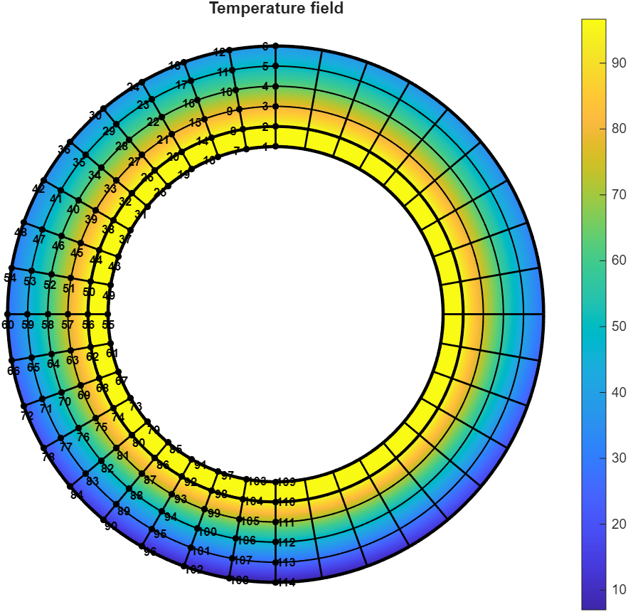
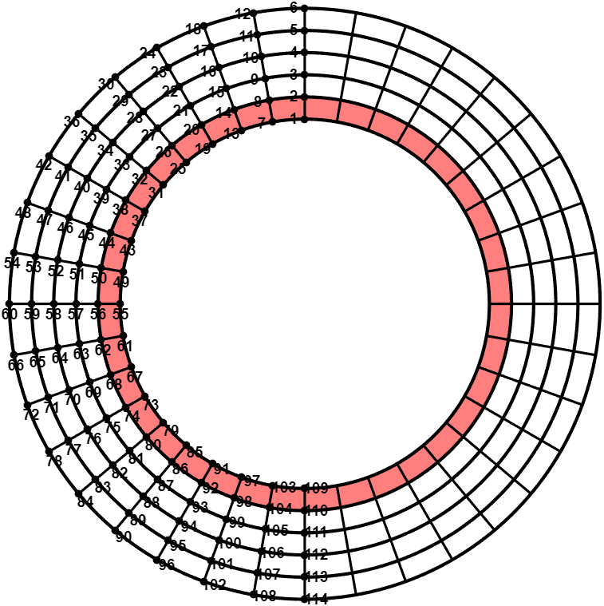
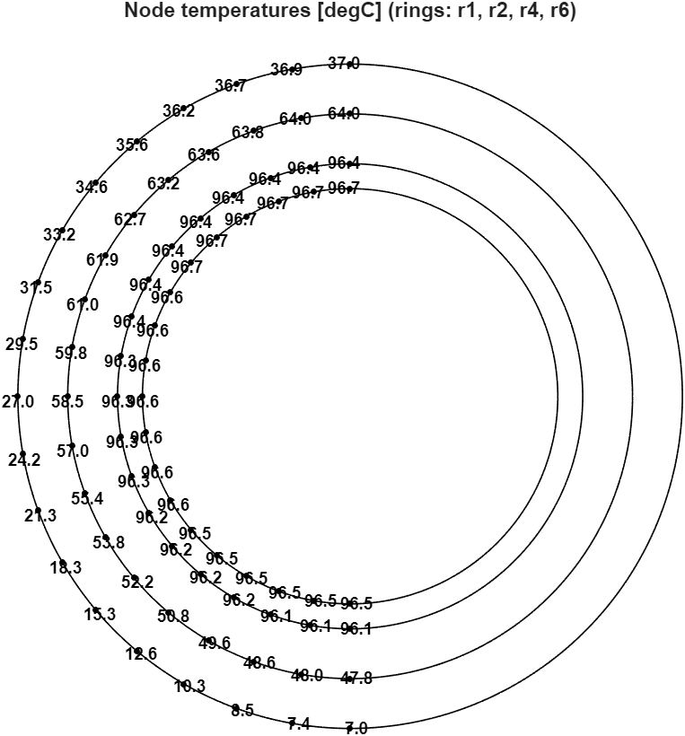

# 2D heat conduction in a composite pipe wall (MATLAB)

Steady-state 2D conduction in the cross-section of a two-material pipe, solved with
finite differences on a polar grid and Gauss-Seidel iteration.

- Inner surface: convection with the fluid (`hf`, `Tf`)
- Material interface at `rM`: continuity of temperature and heat flux (`kA`, `kB`)
- Outer surface: Dirichlet, `T_ext(theta) = 24.5 + 15 cos(theta) - 2.5 cos(2 theta)`,
  with `theta` measured from the top (north) of the pipe
- Only the half section `0 <= theta <= pi` is solved (symmetry about the vertical axis)

## Usage

Run `pipe_conduction_2D.m` in MATLAB. It draws the numbered grid, solves the problem,
and plots the temperature field. If Gauss-Seidel does not converge, the script stops
with an error and produces no plots.

All parameters (`rI`, `rM`, `rO`, `Nr`, `Nth`, `kA`, `kB`, `hf`, `Tf`, tolerance) are at
the top of `pipe_conduction_2D.m`. `rM` must coincide with a grid ring.

## Files

| File | Purpose |
|---|---|
| `pipe_conduction_2D.m` | main script: setup, Gauss-Seidel solver, calls the plots |
| `T_ext_fun.m` | outer boundary temperature |
| `plot_mesh.m` | numbered polar grid |
| `plot_heatmap_full.m` | full 360-degree heatmap with grid and node numbers |
| `plot_heatmap_click.m` | heatmap with clickable nodes (data cursor) |
| `plot_node_temperatures.m` | nodal temperatures on selected rings |
| `interpolate_full_field.m` | helper: smooth full-circle field for plotting |
| `light_figure.m` | helper: white-background figure (works with the MATLAB dark theme) |

Node numbering: `i = (g-1)*Nr + ir`. Radial neighbours are `i-1`, `i+1`; angular
neighbours are `i-Nr`, `i+Nr`.

Reference result (Nr = 6, Nth = 19): 66 iterations, Tmax = 96.665 degC, Tmin = 7 degC.

